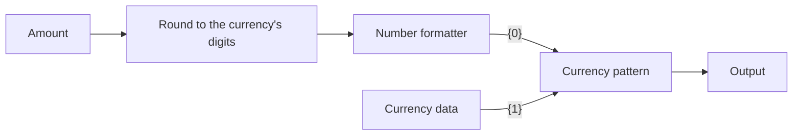

# Currency formatter

| | |
|---|---|
| Author | Younies Mahmoud ([@younies](https://github.com/younies)) |
| Status | Implemented in `icu_experimental`; graduation is tracked in [#8159] |
| Code | [`components/experimental/src/dimension/currency`](../../../components/experimental/src/dimension/currency) |

`CurrencyFormatter` formats an amount of money for a locale and a currency. It
follows [UTS #35 Part 3][uts35] and covers what `Intl.NumberFormat` needs for
`style: "currency"`. It puts a number, formatted by `DecimalFormatter` or
`CompactDecimalFormatter`, into a currency pattern. The constructor chooses the
display style, so a formatter loads only the data that style needs.

```rust
use icu::experimental::dimension::currency::formatter::CurrencyFormatter;
use icu::locale::locale;
use icu::locale::preferences::extensions::unicode::keywords::currency;
use writeable::assert_writeable_eq;

let fmt = CurrencyFormatter::try_new_symbol(
    locale!("en-US").into(),
    currency!("USD"),
    Default::default(),
)
.unwrap();
let value = "12345.67".parse().unwrap();
assert_writeable_eq!(fmt.format_fixed_decimal(&value), "$12,345.67");
```

## Goals

- Every currency format in UTS #35: standard and accounting patterns, symbol,
  narrow symbol, ISO code, plural display names, no currency, compact short and
  long forms, and currency-specific separators.
- What `Intl.NumberFormat` needs for currencies.
- Pay for what you use: a formatter for one currency loads data for that
  currency only.
- No heap allocation while formatting.

Not covered yet: scientific and engineering notation, parsing, conversion
between currencies, and currencies outside ISO 4217 ([#8327]).

## What the formatter handles

The examples format `12345.67` or `-12345.67`. They come from the tests in
`format.rs` and `compact_format.rs`.

| Case | Example |
|---|---|
| The locale decides placement and spacing | `en-US` USD: `$12,345.67`; `fr-FR` EUR: `12 345,67 €` |
| Negative amounts | `-$12,345.67`; accounting: `($12,345.67)` |
| A locale's own negative pattern | `de-CH` CHF: `CHF-12'345.67` |
| Display style | `en-US` USD: `$12,345.67`, `USD 12,345.67`, `12,345.67 US dollars` |
| Narrow symbol | `en-US` CAD: `CA$12,345.67`, narrow `$12,345.67` |
| Letters never touch digits | `USD 12,345.67` has a space; `CA$12,345.67` doesn't |
| The currency decides the fraction digits | JPY: `¥12,346`; BHD, no currency: `12,345.670` |
| A locale can give one currency its own separators | `pt-PT` PTE: `12,345$67`; `pt-PT` EUR: `12 345,67 €` |
| Compact forms | `$12K`, `$12 thousand`; `fr-FR` EUR: `12 k €` |
| No currency | `12,345.67`; accounting: `(12,345.67)` |

The spaces are the no-break spaces that CLDR uses: U+202F and U+00A0 in
`fr-FR`, and U+00A0 after `USD`.

## Design

### A currency pattern around a number



`CurrencyFormatter<V>` holds a number formatter `V` (`DecimalFormatter` or
`CompactDecimalFormatter`), the currency data, the usage (standard or
accounting), and the currency's fraction rules. `format_fixed_decimal` works in
four steps:

1. Round the amount to the currency's fraction digits and rounding increment.
2. Format the absolute value with `V`.
3. Pick the pattern from the sign, the usage, and whether the symbol starts or
   ends with a letter.
4. Fill the pattern: `{0}` is the number and `{1}` is the currency.

If the locale has an explicit negative pattern, such as accounting
parentheses, that pattern carries the sign. Otherwise the minus sign goes in
front of the whole result, as UTS #35 says, which gives `-$12,345.67`.

The number style (decimal, compact short, compact long) and the currency style
(symbol, narrow symbol, code, name, none) vary independently, so composing them
gives every combination from one implementation.

### The constructor chooses the display style

| Display style | `CurrencyFormatter<DecimalFormatter>` | `CurrencyFormatter<CompactDecimalFormatter>` |
|---|---|---|
| Symbol | `try_new_symbol` | `try_new_compact_symbol`, `try_new_compact_long_symbol` |
| Narrow symbol | `try_new_symbol_narrow` | `try_new_compact_symbol_narrow`, `try_new_compact_long_symbol_narrow` |
| ISO code | `try_new_code` | `try_new_compact_code`, `try_new_compact_long_code` |
| Name | `try_new_name` | `try_new_compact_name`, `try_new_compact_long_name` |
| No currency | `try_new_no_currency` | |

Each comes in the usual three versions: compiled data, `_unstable`, and
`_with_buffer_provider`. All of them take preferences (the locale and `-u-nu`)
and a `CurrencyType`. All except the name constructors also take
`CurrencyFormatterOptions`, whose only field is `usage` (`Standard` or
`Accounting`), because UTS #35 has no accounting form for names.

[#7785] asks for the display style as an option. We use one constructor per
style instead, because an option would make every formatter load symbols,
display names, and plural rules. This way, a code formatter never loads
symbols, and a symbol formatter never loads names or plural rules. A
constructor that takes the style as an option can still be added later for
callers who want the ECMA-402 shape and accept the extra data.

| Constructor | Data it needs |
|---|---|
| Symbol, narrow symbol | Patterns, one symbol, no-currency patterns, fractions, number symbols |
| Code | Patterns, fractions, number symbols |
| Name | One display name, plural unit patterns, plural rules, fractions, number symbols |
| No currency | No-currency patterns, fractions, number symbols |

The compact constructors also load the compact number patterns.

### Data

| Marker | Keyed by | Holds | Size |
|---|---|---|---|
| `CurrencyEssentialsV1` | Locale | Standard and accounting patterns, each stored once | 1.3 KB + 2.0 KB |
| `CurrencySymbolsV1` | Locale and `USD`, or `USDn` for narrow | One symbol and two flags | 12 KB + 26 KB |
| `CurrencyExtendedDataV1` | Locale and `USD` | Display names by plural category | 200 KB + 2.1 MB |
| `CurrencyPatternsDataV1` | Locale | Unit patterns by plural category, such as `{0} {1}` | 0.1 KB + 0.2 KB |
| `CurrencyPatternsNoCurrencyV1` | Locale | Patterns without the currency | 0.9 KB + 0.3 KB |
| `CurrencyFractionsV1` | Nothing: one payload | Fraction digits and rounding, also for cash | One payload |
| `CurrencyDecimalSymbolsV1` | Locale and `PTE`, or `arab/PTE` | Separators for currencies a locale singles out | 0.1 KB + 0.5 KB |

Sizes cover all locales in the baked data, as lookup table plus payloads. They
come from `provider/data/experimental/fingerprints.csv` at `ddec72453a`
(October 15, 2026).

The decisions behind this data:

- Per-currency data is keyed by marker attributes. A formatter loads one
  symbol, one name, or one set of separators, and a data slice can hold only
  the currencies an app uses. This matters most for display names, which take
  2.1 MB for all currencies.
- Each pattern is stored once per locale and referenced by a 1-byte index, so
  a locale whose standard and accounting patterns are the same stores one
  pattern.
- The `alphaNextToNumber` patterns are their own entries. Datagen records
  whether each symbol starts or ends with a letter, so the formatter never
  classifies characters while formatting.
- Fraction data doesn't depend on the locale, so it is a singleton. It lists
  only the currencies that differ from the default of 2 digits.
- Currency-specific separators are a separate marker that holds a full
  `DecimalSymbols`. The currency formatter wraps its data provider, so
  `DecimalFormatter` asks for the currency's separators first and falls back to
  the locale's. `DecimalFormatter`'s API doesn't change, and currencies without
  their own separators cost nothing. The baked data has 11 such entries, such
  as `pt-PT` PTE and `ca` ESP. The design discussion is in [#8300].

### Fallbacks

- A missing narrow symbol falls back to the standard symbol in datagen (UTS #35
  lateral inheritance, [#8486]), so the formatter makes one request.
- If the locale has no symbol for the currency, the formatter writes the ISO
  code in the symbol pattern: `XYZ 12,345.67`.
- If CLDR says the currency has no symbol, the formatter uses the no-currency
  pattern. CLDR marks this with U+200B, as for PTE in `pt-PT`, where `$` is the
  decimal separator. Datagen stores an empty string instead, and the formatter
  checks for it, because formatting U+200B would leave a trailing space
  ([CLDR-19771]).
- If there is no display name, the formatter writes the ISO code in the unit
  pattern, as UTS #35 says: `12,345.67 XYZ`.

## ECMA-402

| `Intl.NumberFormat` | ICU4X |
|---|---|
| `currencyDisplay` | One constructor per style (see [#7785]) |
| `currencySign` | `CurrencyFormatterOptions::usage` (see [#7786]) |
| `notation: "compact"` and `compactDisplay` | The `try_new_compact_*` and `try_new_compact_long_*` constructors |
| Digit and rounding options, `signDisplay` | Not yet: the formatter always rounds to the currency's digits |
| `formatToParts` | Not yet ([#8455]) |
| `notation: "scientific"` and `"engineering"` | Not planned yet |

## FFI

There are no FFI bindings for currency formatting yet, and graduation needs
them ([#8159]). The plan is to mirror Rust: one `create_*` constructor per
display style that takes a `Locale` and a currency code string, plus a
`format(&Decimal, &mut DiplomatWrite)` method. Two questions are open:

- An invalid currency code string needs a defined error.
- Thirteen constructors may be too many for the bindings. One constructor with
  a style parameter would be smaller, but it would load all the data.

## Size and performance

- `format_fixed_decimal` writes straight to the output through `Writeable`.
  It copies the input `Decimal` to round it, and `Decimal` keeps only 8 digits
  inline, so longer amounts allocate. No test checks allocations yet.
- There are no benchmarks yet; `components/experimental/benches` only covers
  transliteration.
- `CurrencyFormatter` has no `size_test!` yet.

## Known gaps

- Rounding uses half-expand, but UTS #35 says half-even. Cash digits and cash
  rounding are in the data but not used ([#8153], [#8214]).
- `fixed_decimal::Decimal` may not be the right input type for money
  ([#8146]).
- The name constructors load the root locale's unit patterns instead of the
  requested locale's, which is wrong for locales such as `ja` and `ro`.
- When there is no display name, the ISO code fallback always uses the `other`
  unit pattern instead of the plural rules.
- Compact forms don't use currency-specific separators yet ([#8454], [#8489]).
- Patterns that vary by numbering system aren't supported ([#3838]).
- Per-currency patterns from CLDR, such as EUR in `en-150`, are ignored
  ([#5480]).

## Spec questions found while building this

- ISO codes use the `alphaNextToNumber` pattern ([CLDR-19649]).
- A symbol that is also the decimal separator leaves a trailing space
  ([CLDR-19771]).
- Compact forms for currencies with their own separators ([CLDR-19798]).
- Which formats use the currency separators ([CLDR-19825]).
- The "0" pattern in compact currency formats ([CLDR-19633]).

[uts35]: https://www.unicode.org/reports/tr35/tr35-numbers.html#Currencies
[#3838]: https://github.com/unicode-org/icu4x/issues/3838
[#5480]: https://github.com/unicode-org/icu4x/issues/5480
[#7785]: https://github.com/unicode-org/icu4x/issues/7785
[#7786]: https://github.com/unicode-org/icu4x/issues/7786
[#8146]: https://github.com/unicode-org/icu4x/issues/8146
[#8153]: https://github.com/unicode-org/icu4x/issues/8153
[#8159]: https://github.com/unicode-org/icu4x/issues/8159
[#8214]: https://github.com/unicode-org/icu4x/issues/8214
[#8300]: https://github.com/unicode-org/icu4x/issues/8300
[#8327]: https://github.com/unicode-org/icu4x/issues/8327
[#8454]: https://github.com/unicode-org/icu4x/issues/8454
[#8455]: https://github.com/unicode-org/icu4x/issues/8455
[#8486]: https://github.com/unicode-org/icu4x/issues/8486
[#8489]: https://github.com/unicode-org/icu4x/pull/8489
[CLDR-19633]: https://unicode-org.atlassian.net/browse/CLDR-19633
[CLDR-19649]: https://unicode-org.atlassian.net/browse/CLDR-19649
[CLDR-19771]: https://unicode-org.atlassian.net/browse/CLDR-19771
[CLDR-19798]: https://unicode-org.atlassian.net/browse/CLDR-19798
[CLDR-19825]: https://unicode-org.atlassian.net/browse/CLDR-19825
