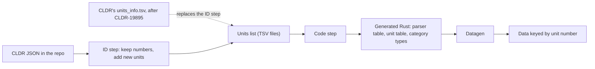

# Units in ICU4X: stable IDs, pre-built units, and conversion

| | |
|---|---|
| Author | Younies Mahmoud ([@younies](https://github.com/younies)) |
| Status | Draft |
| Last updated | 2026-11-10 |
| Issue | [#8678](https://github.com/unicode-org/icu4x/issues/8678) |
| Epic | [#8157](https://github.com/unicode-org/icu4x/issues/8157) (Units Formatter Graduation) |
| CLDR | [CLDR-19895](https://unicode-org.atlassian.net/browse/CLDR-19895), draft [unicode-org/cldr#6263](https://github.com/unicode-org/cldr/pull/6263) |
| Related | [#6745](https://github.com/unicode-org/icu4x/issues/6745), [#6161](https://github.com/unicode-org/icu4x/issues/6161), [#8269](https://github.com/unicode-org/icu4x/issues/8269), [#2197](https://github.com/unicode-org/icu4x/issues/2197), [#8125](https://github.com/unicode-org/icu4x/issues/8125), [#8673](https://github.com/unicode-org/icu4x/issues/8673) |

**Proposal:** Generate ICU4X's units from a checked-in list that gives every
unit a stable number. A new task, `cargo make units-codegen`, keeps every
number it has given out, numbers new units after the last one, and writes the
parser table and a constant for each pre-built unit. Datagen keys unit data by
these numbers.

Later pull requests build on the list, in this order:

1. Pre-built units, one category per PR, with display names split into simple
   and other units.
2. Convertible units that carry their conversion factor.
3. Mixed units with a cascading converter and cascading rounding, then smart
   units conversion and formatting.

[CLDR-19895](https://unicode-org.atlassian.net/browse/CLDR-19895) proposes
that CLDR generate the same list. Until the CLDR TC accepts it, ICU4X uses its
own generator with fixed numbers, starting from CLDR's proposed ones. Once CLDR
accepts the proposal, CLDR's generator replaces ours for the numbers.

**The stable numbers are the core of the design.** A number means the same unit
in every ICU4X version, and it is never reused. This doc says *unit number* for
the stable ID and *unit ID* for CLDR's string, such as `kilometer`.

## Objective

Taking a new CLDR release's units should be a regeneration step, not a round of
hand edits. Every unit that CLDR names should have a typed constructor that
needs no data. Mixed units like `foot-and-inch` should convert and round the way
ICU does.

Goals:

- Stable unit numbers in code and data, matching CLDR's proposal.
- One command that regenerates the units after a CLDR upgrade, checked by CI.
- `const` constructors for the pre-built units of every category.
- Display-name data keyed by unit number and split into simple and other units.
- Convertible units, mixed units with cascading rounding, and smart units
  conversion and formatting.

Non-goals:

- Formatting units without their own names, such as `square-foot-per-second`.
  This design prepares the data, but that formatter needs its own design
  ([#2194](https://github.com/unicode-org/icu4x/issues/2194)).
- FFI. Graduation needs it
  ([#8157](https://github.com/unicode-org/icu4x/issues/8157)), but the Rust API
  comes first.
- Unit numbers in public APIs. APIs keep CLDR's unit IDs, and the numbers stay
  inside code and data, as in CLDR's proposal.
- Changing how units are sorted into Core, Extended, and Outlier. That stays as
  is, with the fix in [#8668](https://github.com/unicode-org/icu4x/pull/8668).
- Beaufort, which has no factor.
  [#8673](https://github.com/unicode-org/icu4x/issues/8673) tracks it.

## Background

### What ICU4X has today

ICU4X's units code lives in `icu_experimental` and has these gaps:

- Unit numbers are defined in code (`measure/parser/ids.rs`), and datagen reads
  the same code, but every number is assigned by hand.
- Nothing keeps a number from changing or being reused: number 0 was reused for
  `cup-imperial`, and `part` moved from 155 to 113
  ([#6793](https://github.com/unicode-org/icu4x/pull/6793),
  [#8266](https://github.com/unicode-org/icu4x/pull/8266)).
- Only simple units have numbers: the 157 units in CLDR's conversion data,
  which also include `kilogram`, the base unit of mass. Of the 235 units with
  formatting data in CLDR 49, 81 have no number, such as `kilometer`,
  `square-meter`, and `kilometer-per-hour`.
- Only 16 units have constructors, in 5 categories, written by hand. They read
  baked constants from the `UnitsIdV1` marker, so they need `compiled_data`.
- Display names sit in 15 markers, keyed by each unit's full name, such as
  `long-square-meter`: 29,791 keys, 365 KB of lookup tables, and 804 KB of
  payloads. The lookup is a trie, so shared prefixes are stored once, but
  nothing shortens the keys themselves yet.
- A unit parsed from a string has no CLDR name, so formatting it hits
  `unimplemented!()`. `DurationFormatter::try_new_unstable` does exactly that.
- The converter handles simple, compound, reciprocal, and offset conversions.
  There is no support yet for mixed units, rounding across units, or unit
  preferences.

### What CLDR is doing

[CLDR-19895](https://unicode-org.atlassian.net/browse/CLDR-19895) proposes
generated files with one row per unit: a stable number for every unit,
category, and quantity, and the exact factor to the base unit (draft
[cldr#6263](https://github.com/unicode-org/cldr/pull/6263)). ICU's draft
generator for its built-in units reads the same files
([icu#4329](https://github.com/unicode-org/icu/pull/4329)).

For CLDR 49 the list has 249 rows: 238 named units and 11 deprecated IDs, in 43
quantities and 22 categories. Of the 238, 157 are simple, 43 prefixed, 14 have a
power, and 24 are compound. The CLDR TC hasn't accepted the proposal, so ICU4X
can't depend on it yet, but it can use the same format and numbers now.

## Design

### Overview



Both steps run in `cargo make units-codegen`. The units list is the only place
numbers live: the generator turns it into Rust code, and datagen uses that code,
as it uses `ids.rs` today.

### 1. The units list and its numbers

The list is three TSV files in `components/experimental/data/units/`:
`units_info.tsv`, `unit_quantities.tsv`, and `unit_categories.tsv`. They use
CLDR's format and column names, so CLDR's files can replace them as they are;
the generator ignores columns it doesn't use. The first version comes from the
CLDR 49 files in cldr#6263, so `meter` is 127, `kilometer-per-hour` is 192, and
the `length` quantity is 22.

The numbers follow CLDR's five rules:

1. A number never changes.
2. A number is never reused, even after its unit is deprecated.
3. A new unit gets the next free number, in category, then unit order, like
   CLDR's tool.
4. A unit that leaves CLDR stays in the list as `deprecated`, with its number.
5. Numbers are unique across quantities and categories, so a number alone finds
   a unit.

A unit is anything with its own names in `und` or `en`, plus anything in CLDR's
conversion data (`convertUnits`). For CLDR 49 that gives exactly CLDR's 238
units. The four `*-person` duration units come in through the conversion data:
CLDR's root locale names them through aliases, which cldr-json drops, so only
`day-person` has names there (in 161 locales). That is why cldr-json has
formatting data for 235 of CLDR's 238 units.

### 2. The generator

`cargo make units-codegen` runs the generator. It lives in the existing
`tools/make/codegen` tool, which already writes the property enums from
Unicode's data files. So `cargo make codegen` runs it too, and CI's
`codegen-check` fails when its output is stale.

The ID step reads CLDR's units from the JSON that
`cargo make download-repo-sources` keeps in `provider/source/tests/data/cldr`.
It keeps every row, adds new units with new numbers, and marks missing units
deprecated. For a new row, it takes the category from the locale data and works
out the complexity and quantity from CLDR's conversion data, as CLDR's tool
does.

The code step then reads the list and writes:

- the parser table of simple units, which replaces the hand-written `ids.rs`;
- a unit table indexed by number, with each unit's CLDR ID, quantity, category,
  complexity, and parts;
- a trie from each pre-built unit's ID to its number, so a parsed
  `kilometer-per-hour` knows its number and name;
- one type per category, with its constructors (section 4);
- the display-name markers, and the marker lists that the data registry and
  datagen need (section 5).

Running the generator twice changes nothing. Tests check that numbers run from 0
with no gaps or duplicates, and that every name maps to its row's number. A CI
check can also reject a pull request that changes an existing number.

In the first PR, today's 16 constructors switch to the generated numbers. They
stop reading `UnitsIdV1`, so that marker and their `compiled_data` requirement
go away.

After a CLDR upgrade, run `cargo make download-repo-sources`, then
`cargo make units-codegen`, then `cargo make bakeddata`. If CLDR has a unit that
the generated table lacks, datagen fails and says to run the generator, so a
skipped step can't drop units quietly.

### 3. Replacing the ID step with CLDR's files

The ID step, the "ID section" of the generator, is the only part that does
CLDR's job, and it is temporary. When CLDR-19895 lands, CLDR's generator
replaces it:

- ICU4X copies CLDR's files over its own at each CLDR upgrade, as it already
  does with ICU's `prop_numbers.txt`, and deletes the ID step.
- The code step stays the same, because it reads columns by name and ignores
  CLDR's extra columns.
- If CLDR keeps its proposed numbers, nothing is renumbered; if the CLDR TC
  changes them, ICU4X renumbers once.
- ICU and ICU4X share one numbering, because ICU's generator reads the same
  files.

cldr-json doesn't include CLDR's `common/properties/` folder, so
`download-repo-sources` would fetch the files from the CLDR release.

### 4. Pre-built units, category by category

A pre-built unit is a unit with its own names in CLDR, like ICU's built-in
units: every row of the list that isn't deprecated. Each gets a `const`
constructor that needs no data:

```rust
use icu::experimental::measure::category::Length;

let km = Length::kilometer(); // unit 125; no data, no compiled_data
assert_eq!(km.cldr_id(), "kilometer");
```

Pre-built units have at most three parts
(`milligram-ofglucose-per-deciliter`), so they fit a fixed-size form and can be
`const`.

**Created by category, converted by quantity.** Constructors stay on one type
per CLDR category, as today: `Length::meter()`, `Duration::month()`. Each unit
also records its CLDR quantity in the generated table, and only the converter
uses it (section 6). The converter needs it because the category doesn't say
what converts: `month` and `second` share the `duration` category, but CLDR
gives them no conversion.

**Parsed units get their number.** `MeasureUnit` stores the pre-built number
instead of today's CLDR string. Parsing `hour` finds its number through the
trie, so the formatter can name any pre-built unit, and the `unimplemented!()`
goes away.

**One category per pull request.** A list in the generator says which
categories are on, and each PR adds one line to it. Each PR brings:

- the category's generated type and constructors;
- its display-name markers keyed by unit number (section 5), with their datagen;
- for the five existing categories, removal of the old markers and hand-written
  constructors;
- tests that each constructor equals the parsed unit and that each unit has
  names in `en` and `und` (the `*-person` units are an open question).

The generator could emit every category at once. Going one at a time keeps each
PR reviewable and shows each category's data size; the order is in the Plan.

#### Category names

The category types are public API, but CLDR's category names can change. CLDR
renamed `proportion` to `concentr` in CLDR 29, and `karat` moved with it. Some
names are also abbreviations that read badly in Rust, such as `concentr`.

The generator keeps the Rust names stable:

- Each type is tied to its category's stable number in `unit_categories.tsv`,
  and a small table in the generator gives its Rust name, such as
  `Concentration` for CLDR's `concentr`.
- When CLDR renames a category, the old name stays in the list as deprecated,
  with the new one as its replacement (`proportion` points to `concentr`). The
  name table maps both to the same Rust type, so the API doesn't change.
- When a unit moves to another category, it keeps its number, and its
  constructor moves to the new type. The old type keeps a `#[deprecated]`
  constructor for one release.
- Marker names come from the Rust name, such as
  `UnitsNamesConcentrationSimpleCoreV1`, so a CLDR rename doesn't change them
  either.

### 5. Display names: simple and other units

Each category's names data is split in two:

- Simple units, such as `meter`, `foot`, and `second`, are the building blocks
  for composing any unit.
- Other units are prefixed, powered, or compound units with their own names,
  such as `kilometer`, `square-meter`, and `kilometer-per-hour`.

The split follows how UTS #35 names a unit that has no name of its own
([Compound Units](https://www.unicode.org/reports/tr35/tr35-general.html#compound-units)).
It drops prefixes and powers and builds the name from the simple units' names,
plus the locale's prefix, power, and "per" patterns. So the future arbitrary
units formatter, and `Intl.NumberFormat` compounds like `liter-per-second`, need
simple-unit names by number from any category, while other units' names are
needed only when that exact unit is formatted.

Own names still win. As @sffc noted in
[#6745](https://github.com/unicode-org/icu4x/issues/6745), `mile-per-hour`
should format as "mph", not "miles per hour", even in an arbitrary formatter,
and UTS #35 checks for an own name first. That formatter finds
`mile-per-hour`'s number through the trie and loads its own name from Speed's
markers before composing anything.

The markers work like this:

- Keys are `<width>-<unit number>`, such as `long-127` instead of
  `long-meter`. CLDR's unit IDs average 9 characters; the numbers have at most
  3 digits.
- The Core, Extended, and Outlier slices stay for the 13 categories that have
  units in CLDR's unit preferences: area, concentr, consumption, duration,
  energy, force, length, mass, power, pressure, speed, temperature, and volume.
- No locale prefers any unit of the other nine categories, so every unit there
  is an outlier and one marker per kind is enough. The formatter's three slots
  all point at it.
- Marker names follow today's pattern, such as `UnitsNamesLengthSimpleCoreV1`
  and `UnitsNamesLengthOtherCoreV1`.
- The formatter picks simple or other from the unit's complexity in the
  generated table.

Simple names stay per category because of size. A rough count over CLDR 49's
JSON (657 locales, pattern text only) puts simple-unit names at about 1.1 MB and
other names at about 0.9 MB. One marker for every category's simple names would
make a length-only formatter pull in 3.7 times (Core) to 5.6 times (all slices)
the names data it uses today.

This layout has 86 markers for all 22 categories in CLDR 49, against 15 today
for 5 categories. The generator writes them, and the stack adds them one
category at a time, so each PR shows its size change in `fingerprints.csv`.

### 6. Convertible units

A convertible unit is a unit plus its exact conversion to its quantity's base
unit. The conversion is a factor (numerator / denominator × 10^exponent, in
64-bit integers), an offset for temperatures, and whether the factor is exact.
CLDR's tool checks that every factor fits in 64 bits.

How they work:

- Pre-built units get their conversion as generated constants, and parsed units
  get it from the existing `ConverterFactory`.
- A conversion between two convertible units is checked twice: at compile time,
  both must be in the same category; at runtime, both must have the same
  quantity. So `Length` to `Mass` doesn't compile, and `Duration::month()` to
  `Duration::second()` returns an error.
- Two pre-built factors combine exactly in 128-bit integers, then feed today's
  `UnitsConverter<N>`. Parsed compound units keep the factory's big-integer
  math.
- The runtime check also accepts the two reciprocal pairs, which each sit in
  one category: consumption with consumption-inverse (`mile-per-gallon` to
  `liter-per-100-kilometer`), and electric resistance with conductance.
- Torque units share the energy quantity but not its category, so `joule` to
  `newton-meter` goes through the untyped converter.
- `beaufort` (no factor, #8673) and the format-only `generic` aren't
  convertible.

The open decision is whether factors live in code or in data. We recommend
generated code, for four reasons:

- Unit numbers and the parser are already code, and a factor is part of a
  unit's definition, not locale data.
- CLDR's list gives factors as checked integers meant for code generation.
- Typed conversion then needs no data and works in `const`.
- The `UnitsInfoV1` marker (4,657 bytes) can go, which leaves one source of
  truth.

The cost is that a CLDR factor fix needs a code release, as a new unit does
today. The other choice keeps `UnitsInfoV1`, and a convertible unit loads its
factor from it once, when it is created.

### 7. Mixed units, cascading conversion and rounding, and smart units conversion

Mixed units come first. The parser learns `-and-` IDs, which it rejects today,
and a typed mixed unit is built from convertible units of one category and one
quantity, highest first, such as `foot-and-inch` or
`hour-and-minute-and-second`.

The cascading converter works like ICU4C's
[`ComplexUnitsConverter`](https://github.com/unicode-org/icu/blob/main/icu4c/source/i18n/units_complexconverter.cpp).
It converts the value to the largest unit and keeps the whole part, then
converts the rest to the next unit, and so on; the last unit keeps the
fraction, so 1.7 m becomes 5 ft 6.93 in. ICU4X uses exact ratios, so it needs
none of ICU4C's floating-point nudges (`DBL_EPSILON`).

Cascading rounding follows UTS #35
([Mixed Units](https://www.unicode.org/reports/tr35/tr35-info.html#mixed-units)):
round the last unit, and if it reaches the size of the next unit, round the
next unit instead, recursively. So 1.828 m, which is 5 ft 11.97 in, becomes
6 ft 0 in, not 5 ft 12 in. Only the highest unit shows a minus sign.

CLDR hasn't settled the default precision for mixed units
([CLDR-19863](https://unicode-org.atlassian.net/browse/CLDR-19863)) or whether
to drop zero subunits
([CLDR-19883](https://unicode-org.atlassian.net/browse/CLDR-19883)). So the
converter takes the precision as an input.

Smart units conversion and formatting comes last. A new unit preferences marker
holds CLDR's ranked units for each quantity, usage, and region, with their
thresholds and precision. A router picks the output unit for a value, a locale,
and its `-u-ms` and `-u-mu` keywords, runs the cascading converter, and hands
the result to the formatter, so a road distance shows in miles in the US and in
kilometers in France
([Unit Preferences](https://www.unicode.org/reports/tr35/tr35-info.html#Unit_Preferences),
[#2197](https://github.com/unicode-org/icu4x/issues/2197)).

Datagen turns CLDR's precision skeletons, such as `precision-increment/50`, into
rounding options, so ICU4X needs no skeleton parser.

## Compatibility and costs

`icu_experimental` is unstable, so these changes are allowed, and each goes in
the changelog. The first PR renumbers ICU4X's units once (`meter` goes from 85
to 127), so postcard or blob unit data from an older datagen won't work with the
new code; baked data is regenerated with it. After that the numbers don't
change, so data from one version keeps working with the next, as ICU4X's
[design principles](https://github.com/unicode-org/icu4x/blob/main/documents/design/principles.md#stable-data-across-stable-library-versions)
ask.

The new names markers have new names, so old data is never misread; it just
isn't found.

The design also has these costs:

- Many more markers: 86 for every category, though generated.
- API breaks: `UnitsIdV1` goes away, and `MeasureUnit`'s `id` field changes
  type.
- Category types follow CLDR's categories, so a CLDR rename needs the name
  table (Category names).
- The ID step repeats part of CLDR's tool until CLDR-19895 lands.
- Data keyed by numbers is harder to read when debugging.
- A unit that CLDR adds needs a code release before ICU4X can use it, as today.

## Alternatives considered

| Option | Advantage | Why not |
|---|---|---|
| Keep the hand-written `ids.rs` | No tool | Renumbered twice already |
| Number units by sorting at each run | No list to keep | Numbers shift when CLDR adds units |
| Wait for CLDR-19895 | One owner for the numbers | Blocks ICU4X on the CLDR TC |
| Keep ICU4X's current numbers | No renumbering now | Renumbers when CLDR's files land |
| A proc macro, `unit!("meter")` | Checks names at compile time | Every user pays the compile time |
| An enum of all units | Exhaustive matches | The set grows; [enums_or_ids.md](https://github.com/unicode-org/icu4x/blob/main/documents/design/enums_or_ids.md) prefers IDs |
| Create units by quantity | Types match what converts | 43 types; `month` and `year` would leave `Duration` |
| One simple-names marker for all categories | Fewer markers | Length-only formatter pulls in 3.7 to 5.6 times the data |
| No simple and other split | 48 markers instead of 86 | Composing names would pull in every own name |
| Keep string keys (`long-meter`) | Readable data | Longer keys; numbers are stable now |

## Open questions

- cldr-json has no unit aliases (CLDR's `<unitAlias>`), so the parser keeps its
  two aliases, `portion` and `permillion`, by hand until
  [#8269](https://github.com/unicode-org/icu4x/issues/8269) decides how to
  support them.
- The trie matches CLDR's unit IDs exactly, so `hour-kilowatt` doesn't find
  `kilowatt-hour` until the parser normalizes the order of parts
  ([CLDR-19892](https://unicode-org.atlassian.net/browse/CLDR-19892)).
- Where a locale has no names for the four `*-person` units, datagen should use
  the names of `day`, `week`, `month`, and `year`, as CLDR's root locale does.

## Plan

| Section | Pull requests | What they do |
|---|---|---|
| 1, 2 | Units list and generator | List from cldr#6263; `cargo make units-codegen`; `UnitsIdV1` removed |
| 4 | Length | Generated `Length`; names keyed by unit number |
| 5 | Simple and other units | Names markers split in two; later categories start split |
| 4, 5 | Mass, Area, Volume, Duration | One PR each; old markers removed |
| 4, 5 | Other categories | One PR each; Speed, Temperature, Energy, Power first |
| 6 | Convertible units | Generated factors; category and quantity checks |
| 7 | Mixed units | `-and-` parsing; cascading converter and rounding |
| 7 | Smart units conversion and formatting | Preferences marker and router (#2197) |
| 3 | After CLDR-19895 lands | CLDR's generator replaces our ID step |

## Decisions needed

| Decision | Decided by | We recommend |
|---|---|---|
| Start from CLDR's proposed numbers | ICU4X maintainers | Yes |
| Create units by category, use the quantity inside the converter | ICU4X maintainers | Yes |
| Rust names for CLDR categories, such as `concentr` | ICU4X maintainers | A name table in the generator |
| Names keys: `<width>-<unit number>` | ICU4X maintainers | Yes |
| Markers split per category, with slices where CLDR has preferred units | ICU4X maintainers | Yes, generated |
| Conversion factors in code or data | ICU4X maintainers | Code |
| Where ICU4X gets CLDR's files after CLDR-19895 | ICU4X maintainers, CLDR TC | The CLDR release |

## Appendix: files to change

| Area | Files |
|---|---|
| Units list | `components/experimental/data/units/*.tsv` (new) |
| Generator | `tools/make/codegen/src/units.rs` and `templates/units_*.rs.jinja` (new) |
| Task | `units-codegen` in `tools/make/tidy.toml`, next to `codegen` |
| Parser | `measure/parser/ids.rs` (generated) |
| Units and categories | `measure/category/` (generated), `measure/measureunit.rs` |
| Markers | `dimension/provider/units/categorized_display_names.rs` (generated), `provider/registry/src/lib.rs` |
| Formatters | `dimension/units/categorized_formatter.rs`, `duration/formatter.rs` |
| Datagen | `provider/source/src/units/id.rs`, `info.rs`, `categorized_display_name.rs` |
| Docs | `CONTRIBUTING.md`: the list is hard-coded source data |
